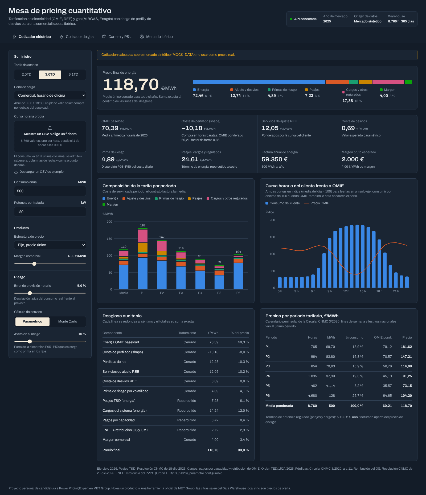
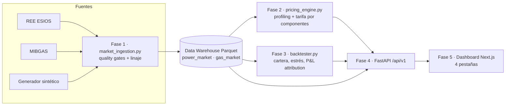
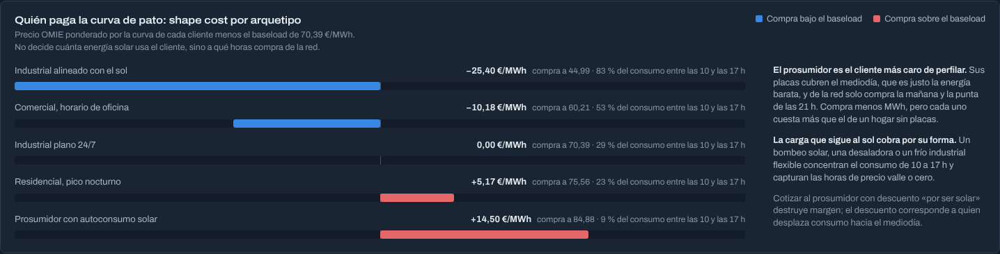
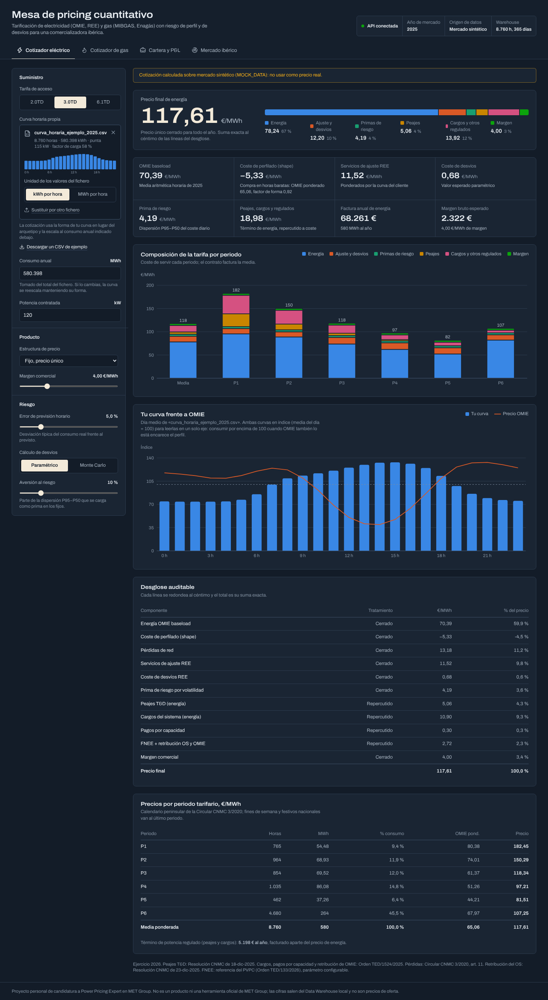
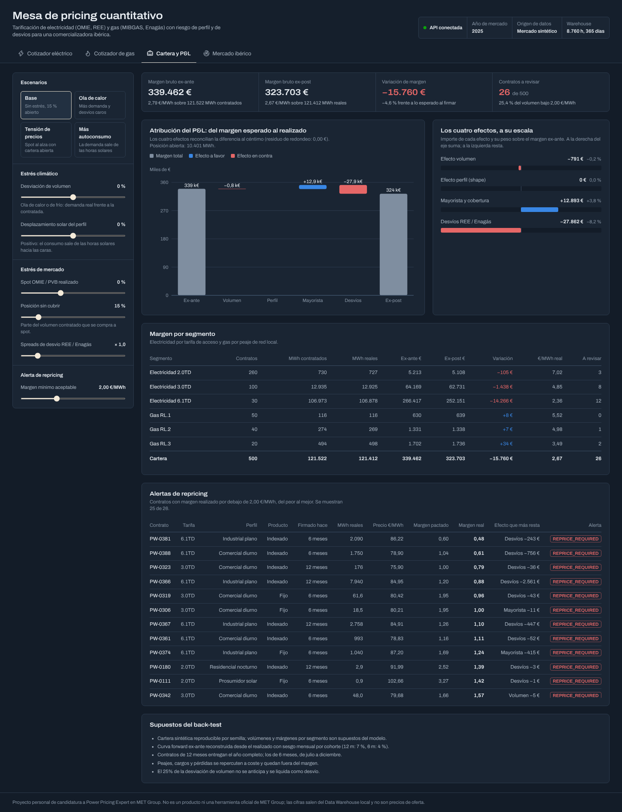

# Enterprise Multi-Commodity Power & Gas Pricing & Imbalance Engine

> Plataforma cuantitativa de tarificación y gestión de cartera para el mercado energético ibérico
> (Electricidad OMIE/REE · Gas Natural MIBGAS/Enagás), diseñada sobre el modelo operativo de una
> comercializadora digital con ADN de *trading floor* y gestión de riesgos.

Proyecto personal construido como caso práctico para la posición de **Power Pricing Expert – MET Group (España)**.
No es un producto ni una herramienta oficial de MET Group.



---

## 1. El problema de negocio

Una comercializadora no vende "energía al precio del pool": vende un **perfil de consumo** que todavía no
conoce con certeza, contra un mercado mayorista horario, con desvíos penalizados de forma asimétrica por REE,
servicios de ajuste crecientes y un gas que marca precio en las horas punta. Fijar mal cualquiera de esos
componentes destruye margen sin que se note hasta la liquidación.

| Pregunta de negocio | Dónde se responde |
|---|---|
| ¿Cuánto cuesta el perfil de este cliente frente al baseload? | `pricing_engine.py`: OMIE ponderado y *shape cost* |
| ¿Cuánto pago por equivocarme en la previsión? | Coste de desvíos REE, paramétrico o Monte Carlo |
| ¿Qué prima cubre volatilidad y opcionalidad? | Prima P95−P50 y prima del cap (call horaria) |
| ¿Qué tarifa ofrezco? | Fijo único, fijo por periodos, indexado, indexado con cap; gas fijo o indexado a PVB |
| ¿Fue rentable la cartera y por qué? | `backtester.py`: ex-ante vs ex-post y atribución en 4 efectos |

---

## 2. Arquitectura



- **Contratos de datos**: cada capa depende del esquema Parquet de la Fase 1, no de la fuente.
- **Todo en memoria en la API**: los Parquet se cargan una vez en el `lifespan`; cotizar tarda milisegundos.
- **Auditable al céntimo**: cada línea del desglose se redondea a céntimos de €/MWh y el precio final es su suma
  exacta en céntimos enteros. El waterfall de P&L reconcilia igual.

---

## 3. Estructura del repositorio

```
Power-Pricing-/
├── README.md · .env.example · .gitignore
├── docker-compose.yml                    # Ingesta + API + dashboard con `docker compose up --build`
├── .github/workflows/ci.yml              # pytest (3.11-3.13), lint + build del frontend y build del stack Docker
├── docs/screenshots/                     # Capturas del dashboard
├── backend/
│   ├── Dockerfile · .dockerignore
│   ├── requirements.txt · pytest.ini
│   ├── app/
│   │   ├── main.py                       # FastAPI: lifespan, CORS, manejo global de errores
│   │   ├── api/routes.py                 # Endpoints v1, MarketStore, inteligencia de mercado
│   │   ├── core/
│   │   │   ├── config.py                 # Settings tipados + .env
│   │   │   ├── regulated.py              # Tablas reguladas y registro de procedencia (BOE/CNMC vs configurable)
│   │   │   ├── pricing_engine.py         # Periodos CNMC, perfiles, motores de electricidad y gas
│   │   │   └── backtester.py             # Cartera de 500 contratos, estrés y atribución de P&L
│   │   ├── models/
│   │   │   ├── tariffs.py                # Modelos de cotización (electricidad y gas)
│   │   │   └── portfolio.py              # Modelos de back-test
│   │   └── pipelines/market_ingestion.py # Fase 1
│   ├── scripts/verify_esios_catalog.py   # Diagnóstico de ESIOS/MIBGAS reales con tu token
│   └── tests/                            # 322 tests: ingesta, pricing, regulados, casos límite, back-test, API y diagnóstico
├── frontend/                             # Next.js (App Router) + TypeScript + Tailwind + Recharts
│   ├── Dockerfile · .dockerignore
│   └── src/{app,components,lib}          # lib/loadCurve.ts: lectura del CSV de curva horaria
└── data/warehouse/                       # Parquet + manifiesto de linaje; los genera la ingesta (no se versionan)
```

---

## 4. Metodología de pricing (Fase 2)

### Electricidad, €/MWh en contador

```
Tarifa = OMIE baseload + Shape + Pérdidas + SSAA + Desvíos + Prima de riesgo + Peajes + Cargos + Capacidad + FNEE/OS/OM + Margen
```

| Componente | Cálculo |
|---|---|
| OMIE baseload | Media aritmética horaria del spot |
| **Shape** | Σ(consumoₕ · spotₕ) / Σ consumo − baseload. Aísla lo que cuesta *la forma* del cliente |
| Pérdidas | Coeficiente por periodo × (spot + SSAA) |
| SSAA | Servicios de ajuste ponderados por la curva |
| **Desvíos** | Error de previsión ~ N(0, σ). Corto → paga (bajar − spot); largo → pierde (spot − subir). Paramétrico: σ/√(2π) · (bajar − subir). Monte Carlo: errores AR(1), devuelve además el P95 |
| Prima de riesgo | Aversión × (P95 − P50) del coste diario ponderado. Solo en productos fijos |
| Peajes y cargos | Término de energía por periodo, calendario de la Circular CNMC 3/2020 |
| Pagos por capacidad | Precio por periodo en barras de central × (1 + pérdidas del periodo) |
| FNEE + OS + OMIE | (retribución OS + retribución OMIE) × (1 + pérdidas) + aportación al FNEE |
| Cap | Indexado con techo K: ahorro esperado −Σ w·max(spot − K, 0) y prima = ese valor histórico × (1 + recargo) |

**Periodos**: 2.0TD con P1 punta, P2 llano y P3 valle; 3.0TD y 6.1TD con P1–P6 por temporada eléctrica.
Sábados, domingos y festivos nacionales de fecha fija van siempre al último periodo.

**Perfiles**: industrial plano, comercial diurno, residencial con pico nocturno, prosumidor solar, industrial
alineado con el sol y curva propia de 8.760 valores (subida por CSV desde el dashboard).

### Caso de estudio: quién paga la curva de pato

El *shape cost* es el OMIE ponderado por la curva del cliente menos el baseload. Con mucha fotovoltaica el
precio se hunde en las horas centrales y se dispara al atardecer, así que el signo no lo decide cuánta energía
solar usa el cliente, sino **a qué horas compra de la red**. Resultado sobre el mercado sintético de 2025
(baseload 70,39 €/MWh; lo devuelve `GET /api/v1/market/intelligence` en `archetype_shapes`):

| Arquetipo | Consumo de red de 10 a 17 h | OMIE capturado | Shape cost |
|---|---|---|---|
| `SOLAR_ALIGNED_INDUSTRIAL` | 83 % | 44,99 | **−25,40** |
| `COMMERCIAL_DAY` | 53 % | 60,21 | −10,18 |
| `INDUSTRIAL_FLAT` | 29 % | 70,39 | 0,00 |
| `RESIDENTIAL_EVENING` | 23 % | 75,56 | +5,17 |
| `SOLAR_PROSUMER` | 9 % | 84,88 | **+14,50** |

- **El prosumidor es el cliente más caro de perfilar.** Sus placas cubren el mediodía, que es la energía barata,
  y de la red solo compra la mañana y la punta de 20–22 h. Compra menos MWh, pero cada uno cuesta más que el de
  un hogar sin placas. Cotizarlo con descuento «por ser solar» destruye margen.
- **La carga que sigue al sol cobra por su forma.** Bombeo solar, desalación o frío industrial flexible operan
  a plena carga de 10 a 17 h y capturan los precios valle o cero.

Los tests fijan ambas propiedades: `shape_cost(SOLAR_PROSUMER) > shape_cost(RESIDENTIAL_EVENING)` y
`shape_cost(SOLAR_ALIGNED_INDUSTRIAL) < 0`.



### Gas natural (RL.1–RL.4)

```
Tarifa = PVB baseload + Forma estacional (HDD) + Mermas + Desbalance Enagás + Prima de riesgo + Peaje variable + Peajes fijos + Cargos y FNEE + Margen
```

El consumo diario es una parte base plana más una parte térmica proporcional a los HDD (base 18 °C); el
*seasonal shape cost* es el PVB ponderado por ese perfil menos el PVB medio.

### Valores regulados: qué es BOE/CNMC y qué es configurable

Todo vive en `backend/app/core/regulated.py`. Cada valor está clasificado y la clasificación se puede consultar
en `GET /api/v1/regulatory/parameters`:

- **OFICIAL**: copiado de la norma citada.
- **REFERENCIA_OFICIAL**: valor oficial usado como aproximación (otro ámbito, otro ejercicio o fuente secundaria).
- **CONFIGURABLE**: hipótesis del comercializador, sin valor regulado único.

**Electricidad, ejercicio 2026**

| Parámetro | Valor | Norma | Clase |
|---|---|---|---|
| Peajes T&D (energía y potencia) | tabla por periodo | Resolución CNMC de 18-dic-2025 | OFICIAL |
| Cargos (energía y potencia) | tabla por periodo | Orden TED/1524/2025 | OFICIAL |
| Pagos por capacidad, €/MWh b.c. | 2.0TD 0,800 / 0,133 / 0 · 3.0TD 1,082 / 0,500 / 0,333 / 0,250 / 0,250 / 0 · 6.1TD 0,465 / 0,213 / 0,142 / 0,107 / 0,107 / 0 | Orden TED/1524/2025, apartado tercero | OFICIAL |
| Coeficientes de pérdidas, % | 2.0TD 16,7 / 16,3 / 18,0 · 3.0TD 16,6 / 17,5 / 16,5 / 16,5 / 13,8 / 18,0 · 6.1TD 6,7 / 6,8 / 6,5 / 6,5 / 4,3 / 7,7 | Circular CNMC 3/2020, art. 11 | OFICIAL |
| Retribución de OMIE | 0,04070 €/MWh b.c. | Orden TED/1524/2025, apartado octavo | OFICIAL |
| Retribución del OS | 0,20332 €/MWh b.c. (provisional) | Resolución CNMC de 23-dic-2025 | OFICIAL |
| FNEE | 2,4374639 €/MWh | Orden TED/133/2026 (RFE del PVPC) | REFERENCIA_OFICIAL · `PRICING_FNEE_EUR_MWH` |

**Gas, año de gas 2027 (1-oct-2026 a 30-sep-2027), consumidores sin telemedida**

| Parámetro | RL.1 | RL.2 | RL.3 | RL.4 | Norma | Clase |
|---|---|---|---|---|---|---|
| Redes locales, fijo (€/cliente·año) | 23,895429 | 64,732693 | 176,302005 | 430,268266 | Resolución CNMC de 27-may-2025, prorrogada el 2-jun-2026 | OFICIAL |
| Redes locales, variable (€/MWh) | 15,240 | 13,172 | 9,782 | 12,887 | ídem | OFICIAL |
| Salida de transporte, fijo (€/cliente·año) | 1,518478 | 5,326102 | 13,012555 | 76,624284 | ídem | OFICIAL |
| Otros costes de regasificación | 0 | 0 | 0 | 0 | Resolución CNMC de 2-jun-2026 | OFICIAL |
| Cargos (€/cliente·año) | 0,29 | 0,55 | 1,08 | 5,43 | Orden TED/1062/2025, vía informe IDAE | REFERENCIA_OFICIAL |

| Parámetro | Valor | Norma | Clase |
|---|---|---|---|
| Tasa CNMC sobre peajes y cargos | 0,140 % | Publicada por MITECO | OFICIAL |
| Cuota del GTS sobre peajes | 1,354 % (año de gas 2026) | MITECO / IDAE | REFERENCIA_OFICIAL · `PRICING_GAS_GTS_QUOTA` |
| Ajuste menor del desbalance en PVB | 3 % | Resolución CNMC de 1-jul-2020 | OFICIAL · `GAS_IMBALANCE_SMALL_ADJUSTMENT` |
| FNEE del gas | 2,4374639 €/MWh | Misma equivalencia que en electricidad | REFERENCIA_OFICIAL · `PRICING_GAS_FNEE_EUR_MWH` |
| Mermas | 0,5 % | Hipótesis | CONFIGURABLE · `PRICING_GAS_SHRINKAGE_RATIO` |

Notas de rigor:

- Las pérdidas vigentes son las de la **Circular CNMC 3/2020**, que sustituyó a las del RD 1164/2001. El
  desbalance gasista se rige por la **Circular CNMC 2/2020** y la Resolución de 1-jul-2020 (antes, Circular
  2/2015 con un ajuste del 2,5 %).
- Pagos por capacidad y retribuciones de OMIE y del OS se publican en barras de central: el motor los eleva a
  contador con el coeficiente de pérdidas del periodo.
- No se repercuten por MWh la cuota fija del OS (200 €/mes por sujeto de liquidación) ni el término de potencia,
  que se informa aparte.
- Pendiente de contrastar contra el BOE antes de un uso real: los cargos gasistas (leídos del informe del IDAE),
  la cuota del GTS del año de gas 2027 y si la CNMC ha actualizado los coeficientes de pérdidas por resolución.
- Los parámetros de modelo (error de previsión, aversión al riesgo, margen, recargo del cap) no son regulados:
  van en cada petición de cotización.

### Reconciliación y casos límite

`tests/test_edge_cases.py` cotiza todas las combinaciones de tarifa (2.0TD, 3.0TD, 6.1TD), producto (fijo único,
fijo por periodos, indexado, indexado con cap) y perfil (los cinco arquetipos y una curva propia) sobre cuatro
mercados: el sintético, uno con OMIE negativo todo el año (baseload −179,61 €/MWh), uno de crisis (×25) y uno a
precio cero. En todos, la suma de las líneas del desglose es el precio final al céntimo, y lo mismo ocurre en
cada periodo. La media ponderada de los precios por periodo solo se separa del precio anual por el redondeo
independiente de cada periodo (menos de 0,03 €/MWh); la API la devuelve en `tou_reconciliation_diff_eur_mwh` y
el dashboard lo indica cuando aparece. El gas se prueba igual en RL.1–RL.4 con consumos de 0,01 a 100.000 MWh, y
las curvas propias con ceros, horas de más o de menos, negativos, infinitos o NaN se rechazan con un 422.

---

## 5. Back-testing y atribución de P&L (Fase 3)

Cartera sintética reproducible de 500 contratos (2.0TD, 3.0TD, 6.1TD, RL.1–RL.3), fijos e indexados, firmados
hace 6 o 12 meses. Para un contrato a precio fijo:

```
M_ex-post − M_ex-ante = Volumen + Perfil + Mayorista + Desvíos

Volumen   = M0 · (V1/V0 − 1)
Perfil    = −V1 · Σ (p1 − p0) · (F + A)
Mayorista = −Σ (V1·p1 − (1−u)·V0·p0) · (S − F)
Desvíos   = π·V1 − I1
```

V volumen, p forma horaria normalizada, F forward al firmar, S spot realizado, A servicios de ajuste,
u fracción sin cubrir, π prima de desvíos cobrada, I1 coste real. En indexados, Perfil y Mayorista son cero.
Un test recalcula ingresos y costes hora a hora y comprueba que coinciden con la suma de efectos.

Escenarios de estrés: `volume_shock_pct`, `shape_shift_pct`, `imbalance_multiplier`, `unhedged_ratio` y
`wholesale_price_shock_pct`. Los contratos con margen realizado bajo el umbral salen con `REPRICE_REQUIRED`.

**Limitación**: el warehouse contiene un solo año, así que la curva forward ex-ante se reconstruye desde el
realizado con un sesgo mensual por cohorte de firma. Con históricos de varios años y curvas OMIP reales ese
supuesto se sustituye sin tocar la atribución.

---

## 6. API REST (Fase 4)

| Método | Ruta | Descripción |
|---|---|---|
| GET | `/api/v1/health` | Estado y metadatos del manifiesto de ingesta |
| POST | `/api/v1/price-quote/power` | KPIs, `build_up`, precios P1–P6 y curva horaria cliente vs OMIE |
| POST | `/api/v1/price-quote/gas` | Desglose RL, *seasonal shape cost* y serie mensual consumo vs PVB |
| POST | `/api/v1/portfolio/backtest` | KPIs, waterfall de P&L, segmentos y contratos en riesgo |
| GET | `/api/v1/market/intelligence` | Curva de pato, asimetría de desvíos, SSAA mensual, correlación OMIE–PVB y shape cost por arquetipo |
| GET | `/api/v1/regulatory/parameters` | Registro de parámetros regulados: valor, norma y si es oficial o configurable |

Errores: 422 para entradas no válidas (`pricing_error` o validación), 503 si el warehouse no se puede cargar y
500 con cuerpo JSON para cualquier fallo no controlado. Documentación interactiva en `/docs`.

---

## 7. Puesta en marcha

```bash
git clone https://github.com/carlossmartins1/Power-Pricing-.git
cd Power-Pricing-
```

### Con Docker (un comando)

Requisito: Docker con Compose v2.24 o posterior.

```bash
docker compose up --build
# Dashboard: http://localhost:3000 · API: http://localhost:8000/docs
```

Los puertos se publican solo en `127.0.0.1`: el stack no es accesible desde otros equipos de tu red.
`ingest` rellena el Data Warehouse si el volumen está vacío (sintético por defecto) y termina; `api` espera a
que acabe y `dashboard` espera a que la API esté sana. Sin `.env` todo arranca en modo sintético; con un `.env`
en la raíz (plantilla en `.env.example`) se usan sus valores, por ejemplo `MOCK_DATA=false` y `ESIOS_API_TOKEN`.

```bash
docker compose run --rm ingest python -m app.pipelines.market_ingestion   # regenerar el warehouse
docker compose run --rm --no-deps api pytest -q                           # tests dentro de la imagen
docker compose down --volumes                                             # parar y borrar el warehouse
```

### En local

Requisitos: Python 3.11+ y Node.js 20.9+.

```bash
# 1) Backend
cp .env.example .env
cd backend
python -m venv .venv && source .venv/bin/activate      # Windows: .venv\Scripts\activate
pip install -r requirements.txt
pytest -q                                              # 322 passed
python -m app.pipelines.market_ingestion --year 2025   # genera los Parquet (modo sintético por defecto)
uvicorn app.main:app --reload --port 8000              # http://localhost:8000/docs

# 2) Frontend (otra terminal)
cd frontend
npm ci
npm run dev                                            # http://localhost:3000
```

Comprobaciones del frontend: `npm run lint`, `npm run typecheck` y `npm run build`.

Si el warehouse está vacío al arrancar, la API ejecuta la ingesta ella misma.

Ejemplo de cotización:

```bash
curl -s -X POST http://localhost:8000/api/v1/price-quote/power \
  -H "Content-Type: application/json" \
  -d '{"tariff":"3.0TD","profile":"COMMERCIAL_DAY","product":"FIXED_TOU","annual_consumption_mwh":850}'
```

El frontend se inicializó con:

```bash
npx create-next-app@latest frontend --typescript --tailwind --eslint --app --src-dir --import-alias "@/*" --use-npm
cd frontend && npm install recharts lucide-react @fontsource-variable/archivo
```

### Integración continua

`.github/workflows/ci.yml` se ejecuta en cada `push` y `pull_request`: `pytest` en Python 3.11, 3.12 y 3.13 más la
ingesta sintética; `npm run lint`, `npm run typecheck` y `npm run build` del frontend; y build, arranque y tests
del stack con Docker Compose.

### Datos reales de REE ESIOS y MIBGAS

Por defecto todo funciona con el mercado sintético (`MOCK_DATA=true`). Para usar datos reales hace falta un token
personal de ESIOS (se solicita a REE). El token va solo en el `.env` de la raíz, que `.gitignore` excluye; nunca
en `.env.example` ni en ningún fichero versionado.

```bash
cp .env.example .env            # y rellena ESIOS_API_TOKEN=...
cd backend
python scripts/verify_esios_catalog.py            # token, catálogo, cada indicador configurado y fichero MIBGAS
python scripts/verify_esios_catalog.py --ingest   # además: ingesta --live --strict y validación de los Parquet
```

El script comprueba que cada ID de `.env` (`600` spot, `686`/`687` desvíos, `807`–`815` servicios de ajuste)
existe en el catálogo actual de ESIOS y devuelve datos de 2025. Si alguno ha cambiado, lo marca con ✗ y propone
candidatos del catálogo para sustituirlo en `ESIOS_INDICATOR_*` / `ESIOS_ANCILLARY_*`. El token nunca se imprime.
Con todo en verde, `python -m app.pipelines.market_ingestion --live --strict` (o `MOCK_DATA=false` en el `.env`
antes de `docker compose up`) deja el warehouse con datos reales. Los IDs por defecto no se han podido contrastar
en vivo desde el entorno donde se desarrolló el proyecto: el script es la verificación.

---

## 8. Dashboard (Fase 5)

| Pestaña | Contenido |
|---|---|
| Cotizador eléctrico | Controles en vivo, cinco arquetipos o **curva propia por CSV**, precio final con regla de composición, KPIs, build-up apilado por periodo, curva horaria cliente vs OMIE y tablas auditables |
| Cotizador de gas | RL.1–RL.4, estacionalidad HDD, desbalance Enagás, consumo mensual frente a PVB |
| Cartera y P&L | Escenarios de estrés, waterfall de atribución, margen por segmento y alertas de repricing |
| Mercado ibérico | Curva de pato OMIE, asimetría de desvíos REE, SSAA por mes, relación gas–electricidad y shape cost por arquetipo |

**Curva horaria propia.** En el cotizador eléctrico se arrastra o elige un `.csv` con 8.760 valores (8.784 en año
bisiesto), uno por hora desde el 1 de enero a las 00:00. El consumo va en la última columna; se admiten cabecera,
columnas de fecha y coma o punto decimal. La curva sustituye al arquetipo, el consumo anual se toma del total del
fichero y la cotización, el build-up y el gráfico frente a OMIE se recalculan con su forma. El botón «Descargar
un CSV de ejemplo» genera un fichero válido (almacén frigorífico, formato español con los dos cambios de hora).





---

## 9. Estado y siguientes pasos

| Fase | Entregable | Estado |
|---|---|---|
| 1 | Ingesta multi-commodity → Parquet con linaje | ✅ |
| 2 | Profiling y tarificación de electricidad y gas | ✅ |
| 3 | Back-testing, estrés y atribución de P&L | ✅ |
| 4 | API REST FastAPI | ✅ |
| 5 | Dashboard Next.js | ✅ |
| 6 | Parámetros regulados oficiales con registro de procedencia, quinto arquetipo, curva por CSV, Docker y CI | ✅ |

Pendiente para un uso real: validar los conectores ESIOS y MIBGAS con token y datos reales, cargar varios años
de histórico y curvas forward OMIP/MIBGAS Derivatives, y contrastar contra el BOE los tres valores marcados
como referencia en la sección de valores regulados.
